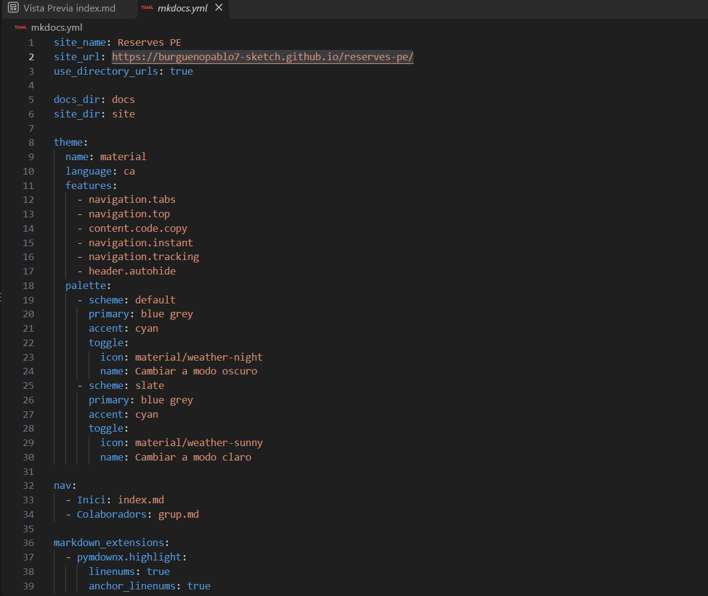
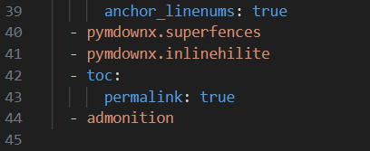
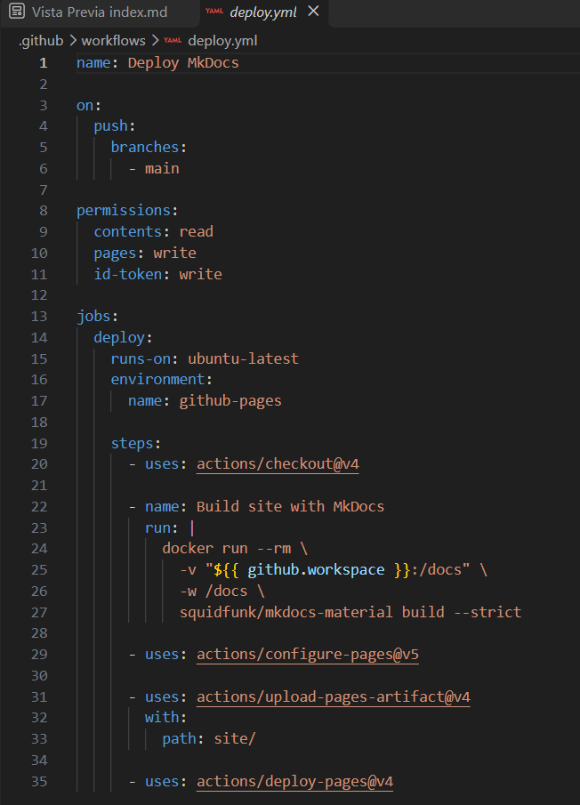
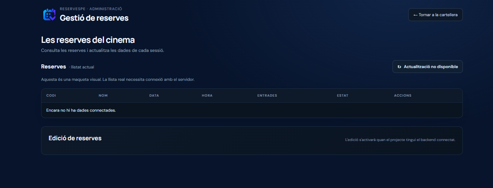

# **Configuracions**

### **Què és mkdocs.yml?**

És l'arxiu de configuració la web. Defineix l'estructura, el disseny, el nom del lloc, els menús de navegació i els complements (plugins) que utilitza MkDocs per generar les pàgines a partir d'arxius Markdown.
Funció principal: Controlar què es mostra a la web i com es veu.

### **Canvis a mkdocs.yml (Disseny de la web)**

Al nostre mkdocs.yml, hem configurat el tema avançat material en idioma català (ca), afegint característiques de navegació fluida i extensions de Markdown per millorar el contingut:

### **Què és deploy.yml?**

És un arxiu de flux de treball (workflow) de GitHub Actions. S'executa automàticament als servidors de GitHub cada vegada que puges canvis (un push) al teu repositori.

Funció principal: Controlar com es publica la web de manera automatitzada (normalment a GitHub Pages). S'encarrega d'instal·lar el programari necessari, compilar els arxius de MkDocs i pujar-los al servidor final.

### **Canvis a deploy.yml**

El nostre arxiu deploy.yml utilitza un contenidor Docker oficial (squidfunk/mkdocs-material). Això empaqueta automàticament MkDocs i totes les seves extensions (pymdownx, admonition, etc.) per compilar la nostra web de manera ràpida i segura a GitHub Pages sense necessitat de gestionar comandes pip.

### **Exemple Pràctic: Afegir la funció de "Cerca Avançada" i "Mode Fosc"**

Imagina que vols fer dos canvis a la teva web:

Activar el mode fosc i el cercador a la interfície (mkdocs.yml).
Actualitzar el procés de publicació automatitzada perquè instal·li les dependències necessàries d'aquest nou tema visual (deploy.yml).

### **Què és DockerCompose**

És l'arxiu de configuració (docker-compose.yml) que ens permet executar el contenidor oficial de MkDocs al nostre ordinador de manera senzilla amb una sola comanda.
Funció principal: Aixecar un servidor local per previsualitzar els canvis i el disseny de la web en temps real, sense necessitat d'instal·lar Python ni cap dependència al nostre sistema.

### **Canvis a DockerCompose**

En lloc de configurar entorns manuals o escriure comandes llargues, aquest arxiu automatitza les proves locals:
Entorn idèntic: Utilitza la mateixa imatge (squidfunk/mkdocs-material) que GitHub per evitar errors de compatibilitat.
Vista en directe: Actualitza la web al navegador automàticament cada vegada que desem un canvi als arxius.

## **Resum**

El canvi a mkdocs.yml transforma visualment la web afegint funcions com el mode fosc i extensions de text. L'ús de docker-compose.yml ens permet provar i veure aquests canvis en temps real al nostre ordinador dins un entorn aïllat. Finalment, el canvi a deploy.yml garanteix que GitHub utilitzi el mateix contenidor Docker per compilar i publicar la web automàticament sense errors.
