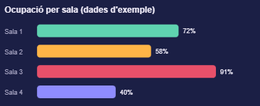

  <h1>🎬 Reserva Cinema 🍿</h1>
  

Aquesta web permet reservar la teva butaca de cinema en segons des del mòbil: **tria la sessió, paga online i entra amb el teu codi QR.** ~~Sense cues, sense taquilla, sense riscos.~~

> El cinema obre de dilluns a diumenge, tots els dies de l'any. La primera sessió comença a les 16:00 h i l'última funció acaba a les 01:00 h.

  <h3>Per a l'espectador</h3>

Pensat per a qui vol veure una pel·lícula sense fer cua a la taquilla i sense arriscar-se a trobar les entrades esgotades.

  <h4>Reserva en 4 passos</h4>

Pel·lícula, sessió, butaca i pagament. Tot es pot fer parlant amb el xat.

  <h4>Pagament i QR</h4>

La reserva només queda confirmada després del pagament online. Llavors rebràs el codi QR per entrar directament a la sala.

  <h2>Passos</h2>

- Tria la **pel·lícula** i la sessió.
- Selecciona la butaca al mapa de la sala.
- Paga online: la reserva **només es confirma** després del pagament.
- Cancel·la o canvia la sessió des de l'app fins a 30 minuts abans.

1. L'usuari parla amb el xat.
2. El sistema bloqueja la butaca en temps real mentre es fa la compra.
3. Si algú altre l'ha triat abans, el xat suggereix seients lliures.
4. Arriba el codi QR i s'entra a la sala sense passar per taquilla.

  <h2>Ocupació de la sala</h2>
  

Ocupació de les sales en una tarda d'exemple. La Sala 3 és la que s'omple abans.

  <h3>Mapa de la sala</h3>
  
  <strong>Shrek · 18:30 · Sala 3</strong>
  
  
📽️ Pantalla 📽️

  
<strong>Fila 1</strong> 🟩🟩🟩🟩🟥🟥🟩🟩🟩🟩🟩🟩🟩🟩

  
<strong>Fila 2</strong> 🟩🟥🟩🟩🟩🟩🟩🟩🟩🟩🟩🟩🟩🟩

  
<strong>Fila 3</strong> 🟩🟩🟩🟩🟩🟩🟩🟩🟥🟥🟩🟩🟩🟩

  
<strong>Fila 4</strong> 🟩🟩🟩🟩🟩🟥🟥🟩🟩🟩🟩🟩🟩🟩

  
<strong>Fila 5</strong> 🟩🟩🟩🟩🟩🟩🟩🟩🟩🟩🟥🟨🟥🟩

  
<strong>Fila 6</strong> 🟩🟩🟥🟩🟩🟩🟥🟩🟩🟩🟩🟩🟩🟩

  
🟩 Lliure · 🟥 Ocupada · 🟨 La teva butaca (Fila 5, Seient 12)

  <h3>La teva entrada</h3>

  <table>
    <tr><th>🎟️ Entrada</th><th>Detalls</th></tr>
    <tr><td>Pel·lícula</td><td><strong>Shrek</strong></td></tr>
    <tr><td>Data</td><td>18 de setembre</td></tr>
    <tr><td>Sessió</td><td>18:30 · Sala 3</td></tr>
    <tr><td>Butaca</td><td>Fila 5, Seient 12</td></tr>
    <tr><td>Preu</td><td>8,50 €</td></tr>
    <tr><td>Accés</td><td>Codi QR</td></tr>
  </table>

  <h1>Xat IA</h1>
  <h3>Butaca lliure</h3>

> 🤖 **Xat:** Hola! 👋 Quina pel·lícula vols veure?
>
> 👤 **Alex:** Shrek
>
> 🤖 **Xat:** Perfecte! 🍿 Sessions: 18:30 (Sala 3), 21:00 (Sala 2), 23:15 (Sala 3). Quina vols?
>
> 👤 **Alex:** La de les 18:30.
>
> 🤖 **Xat:** Quina butaca vols?
>
> 👤 **Alex:** Fila 5, seient 12.
>
> 🤖 **Xat:** ✅ Disponible. El total és de 8,50 €. Per confirmar, fes el pagament online.
>
> 👤 **Alex:** Faig el pagament.
>
> 🤖 **Xat:** 🎉 Reserva confirmada! Aquí tens el teu codi QR.

  <h3>Butaca ocupada</h3>

> 🤖 **Xat:** Quina butaca vols?
>
> 👤 **Alex:** Fila 5, seient 12.
>
> 🤖 **Xat:** ❌ Aquesta butaca acaba de ser seleccionada per un altre usuari. Et puc oferir: Fila 5, seient 11; Fila 5, seient 13; o Fila 6, seient 12.
>
> 👤 **Alex:** Fila 5, seient 13.
>
> 🤖 **Xat:** ✅ Seleccionada. Per confirmar, fes el pagament online.
>
> 👤 **Alex:** No faig el pagament.
>
> 🤖 **Xat:** Reserva no confirmada. La butaca queda lliure per a un altre usuari.
